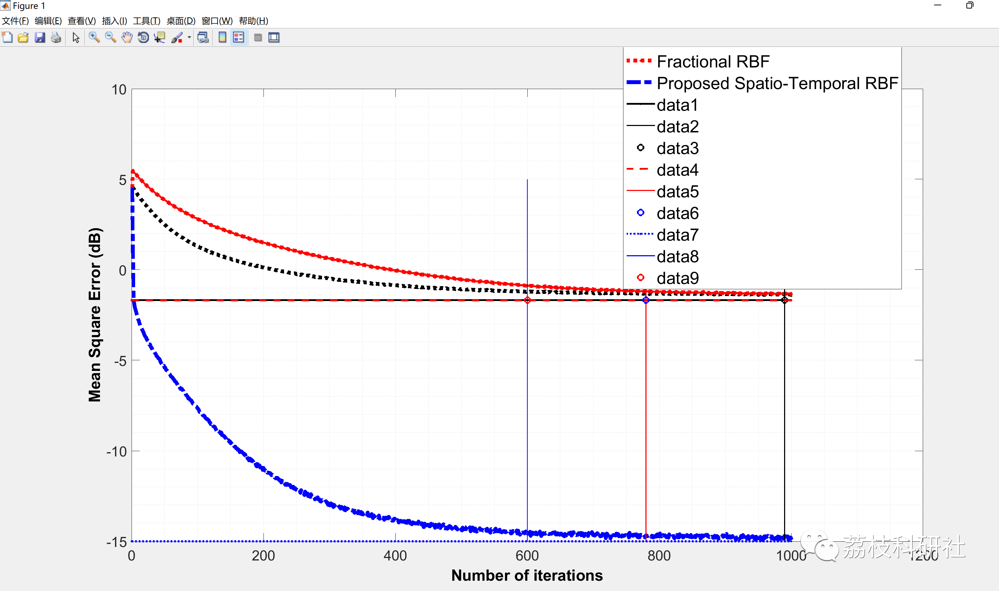
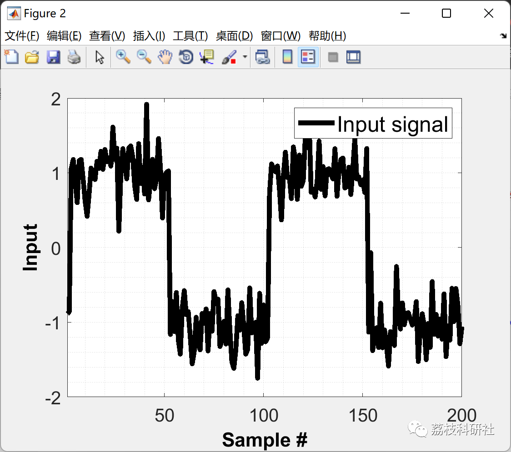
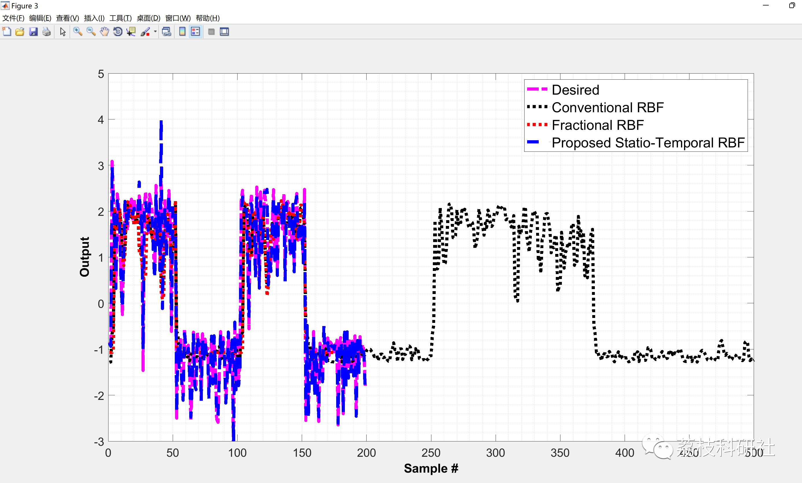
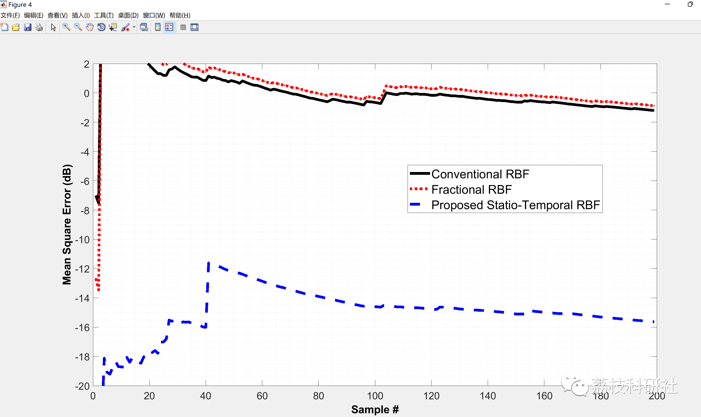
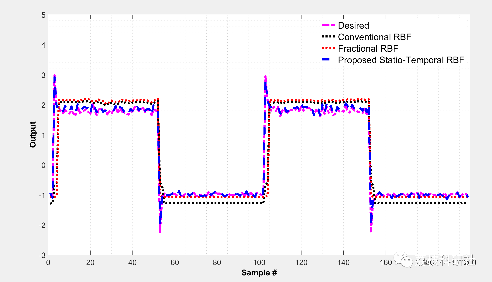
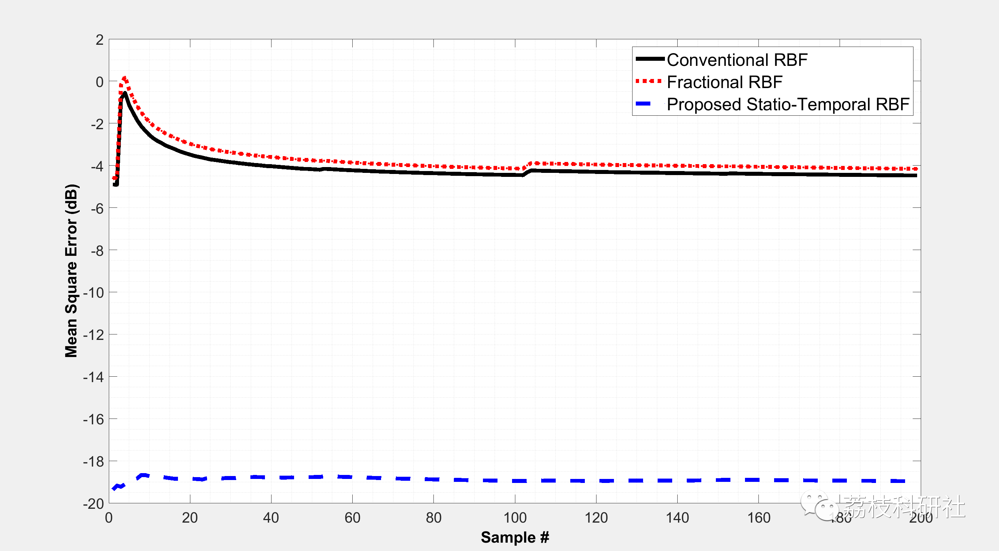
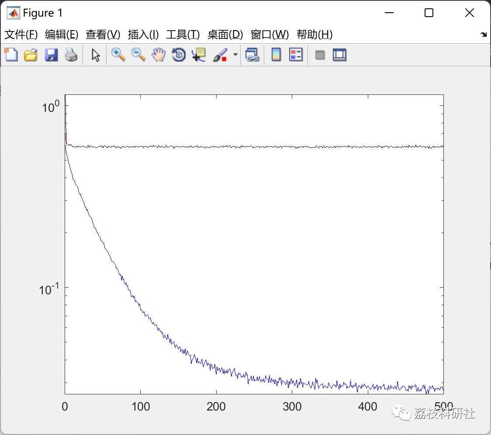
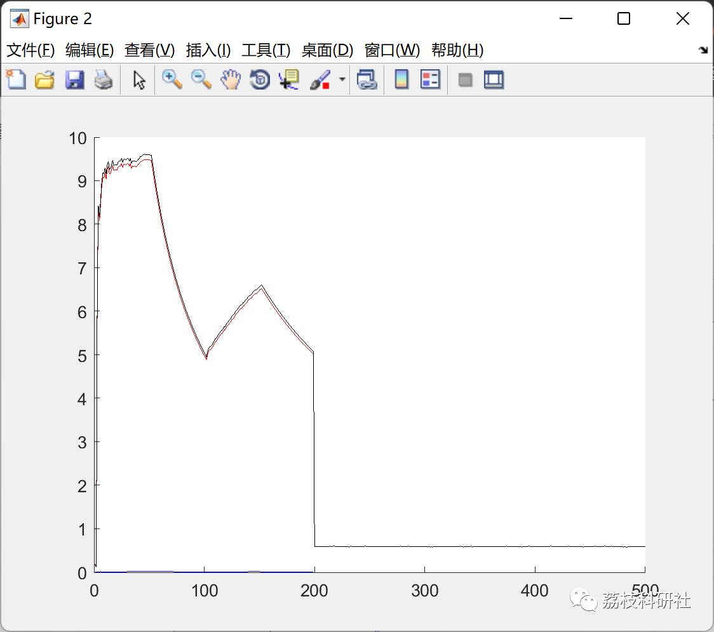
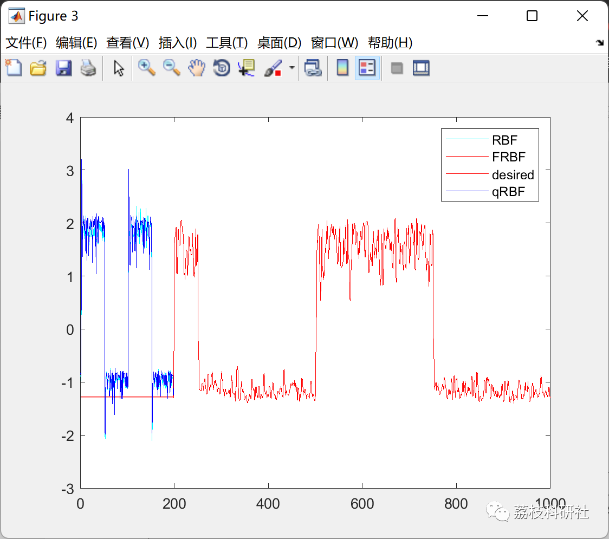

# Nonlinear System Identification Based on Spatio-Temporal RBF-NN (Matlab Code Implementation)

💥💥💥💞💞💞💞 Welcome to this blog❤️❤️❤️💥💥💥
🏆 Bloggers' Advantage: 🌞🌞🌞 The content of the blog strives to be rigorous in thought and clear in logic, for the convenience of readers.
⛳️ Mantra: The journey of a hundred miles is half done in the last ninety.
Litchi Research Society
Code Collection: Power System, Intelligent Algorithms and Applications, Neural Network Prediction, Path Planning, Optimized Scheduling, Workshop Scheduling, Image Processing, Signal Processing...
🎁Column Directory Link:
🌈🌈🌈🌟🌟🌟Electrical Code Intelligent Algorithm and Its Application Path Planning Neural Network Predictive Optimization Scheduling Image Processing Workshop Scheduling Signal Processing Romantic Her My Philosophical Thoughts Math Modeling Complete Code Matters
💥1 Overview
In this paper: RBF, Fractional RBF and Spatio-Temporal RBF neural networks are implemented for nonlinear system identification. Three variants of RBF neural network (RBF-NN) for nonlinear system identification tasks are found. In particular, RBF with conventional and fractional gradient descent is implemented and the performance is compared with that of a spatio-temporal RBF-NN.
For detailed articles, refer to the references.
📚2 Running Results
🎉3 References
[1]Khan, Shujaat, et al. "Spatio-Temporal RBF Neural Networks." 2018 3rd {IEEE} International Conference on Emerging Trends in Engineering, Sciences and Technology ({ICEEST}), {IEEE}, 2018  
🌈4 Matlab code implementation
Click the "Read More" button at the bottom left of the article.

## Images

<!-- PAYMENT_BLOCK -->

## Get this dataset

- Payment link (Stripe): [Buy now](https://buy.stripe.com/3cs8yP7sY87d0vu9AB)
- Payment QR code: 

<!-- /PAYMENT_BLOCK -->
